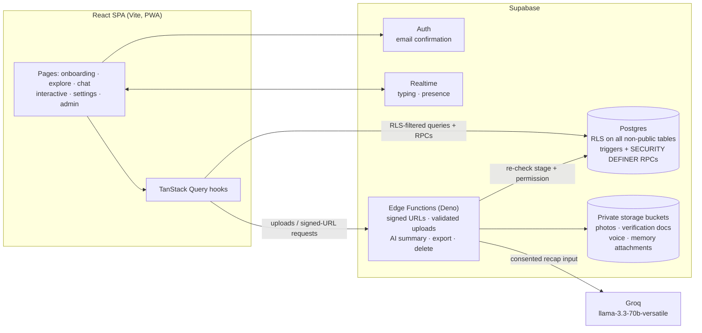

# HeartPath

**Consent-first college dating platform: verified campus access, a six-stage relationship model, and every permission enforced in Postgres.**


[](LICENSE)

A trust-first college dating platform built on **verified identity, intentional pacing, and revocable consent at every layer**. HeartPath replaces swipe culture with a curated daily discovery feed and a six-stage progression model in which every intimacy unlock — a closer photo, a voice note, an exclusive bond — must be explicitly granted by both partners and can be revoked at any time.

> **Status:** v1.0.0 — all 11 Phase 1–3 pull requests ([#1](https://github.com/rupeshbharambe24/HearthPath/pull/1)–[#11](https://github.com/rupeshbharambe24/HearthPath/pull/11)) are merged into `main`. It is a working pilot-stage prototype, not a launched product: there is no public deployment and no automated test suite yet (security rules are checked with manual `_verify.sql` probes). See the [v1.0.0 release note](docs/releases/v1.0.0-phase1-2-3.md).

## Contents

- [Why this exists](#why-this-exists) · [Six stages](#the-heartpath--six-stages) · [Permission unlocks](#permission-unlocks) · [Verification](#verification)
- [Architecture](#architecture) · [Tech stack](#tech-stack) · [Project structure](#project-structure)
- [Local development](#local-development) · [Routes](#routes) · [Documentation](#documentation) · [Status and roadmap](#status-and-roadmap) · [License](#license)

---

## Why this exists

Mainstream dating apps optimize for matches per minute. That's the wrong metric for college students: it produces fake identities, pressure to escalate, and asymmetric vulnerability between partners. HeartPath is built around three opinionated constraints:

1. **Verified college access only.** Every user must prove they belong to a real college through an approved email domain or a manually reviewed student ID. Outside that gate, the app does nothing.
2. **Curated, intent-aware matching.** Discovery is a small daily set ranked by compatibility, not an endless feed. Users declare their intent (friendship, slow burn, serious, same campus) up front so partners are aligned on what they're exploring.
3. **Progressive consent.** Relationships move through six stages. Each stage transition is mutual. Each new permission (private photos, voice notes, AI-shared recap, exclusive mode) is a separate explicit grant the recipient holds and can revoke.

---

## The HeartPath — six stages

Every relationship is a row in `relationships` that progresses through:

| # | Stage | What it means | What unlocks |
|---|-------|---------------|--------------|
| 1 | Stranger | Default; minimal profile, low pressure | Level-1 photo, name, college |
| 2 | Acquaintance | First mutual stage; basic curiosity | Branch / hobbies become visible |
| 3 | Friend | Trust forming through consistency | `voice_notes`, `deeper_profile_details` permissions become grantable |
| 4 | Close Friend | Deeper bond; shared moments | `private_photo_gallery`, `shared_memory_vault` |
| 5 | Romantic Interest | Acknowledged emotional closeness | `full_face_photo`, `ai_shared_recap_access` |
| 6 | Exclusive | Mutual commitment; discovery locked | All permissions; `exclusive_locked_at` set |

Rules enforced at the database layer:

- Stage requests must originate from the caller; no forging from a partner's identity.
- Only the next stage may be requested. No skipping.
- The originator cannot resolve their own request — only the partner can accept, decline, or defer.
- Decline triggers a seven-day cooldown before another request is permitted.
- Permissions cannot be granted below their required stage even via a direct API call.
- Only the granter of a permission may revoke it; only the `revoked_at` field is mutable after grant.

---

## Permission unlocks

Permissions live in `relationship_permissions` and gate access to specific intimacy layers:

| Permission | Required stage | What it grants |
|---|---|---|
| `voice_notes` | 3 | Send and play voice messages in chat |
| `deeper_profile_details` | 3 | View extended profile fields |
| `private_photo_gallery` | 4 | View `level_3` photo set via signed URL |
| `shared_memory_vault` | 4 | Co-author shared journal entries |
| `full_face_photo` | 5 | View `level_4` (full-face) photo |
| `ai_shared_recap_access` | 5 | See AI-generated relationship recaps |

Cross-user photo viewing always goes through the `signed-photo-url` edge function, which re-checks `viewer_can_see_photo_level()` against the current relationship state and permission grants before issuing a five-minute signed URL. The `profile-photos` storage bucket is private; the only direct read path is the `profile_photos_self_read` policy, used by the user viewing their own gallery.

---

## Verification

A user account passes through `access_state`: `verification_pending → onboarding_required → active` (or `blocked`).

Three verification paths populate `verification_badges`:

| Type | Method | Mode |
|---|---|---|
| `email_verified` | Supabase email confirmation | Automatic |
| `student_verified` | College email domain match against `college_domains`, **or** manual ID upload reviewed by an admin | Automatic / manual |
| `photo_verified` | Reserved for future selfie + ID liveness | Future |
| `identity_verified` | Reserved | Future |

Student ID uploads are validated server-side by the `upload-verification-doc` edge function: MIME allowlist (JPEG, PNG, WebP, PDF), 5 MB cap, magic-byte sniffing, and a MIME-versus-content cross-check. Direct client writes to the `verification-documents` bucket are denied.

Admins review pending submissions through `/admin/verifications`. Admin role is stored in the `admin_users` table and checked via the `is_admin()` `SECURITY DEFINER` RPC; there is no client-side allowlist.

---

## Architecture



The client never reads another user's private media directly: every cross-user read goes through an edge function that re-checks the relationship stage and permission grant in Postgres, then returns a short-lived signed URL.

---

## Tech stack

**Frontend**
- React 18, Vite, TypeScript
- shadcn/ui (Radix primitives), Tailwind CSS, Framer Motion
- React Router v7, TanStack Query, React Hook Form + Zod
- Sonner for toasts, Vaul for mobile drawers
- react-i18next (en / hi locale stubs), vite-plugin-pwa

**Backend**
- Supabase (Postgres, Auth, Storage, Realtime, Edge Functions)
- All non-public tables enable Row-Level Security
- Authoritative integrity rules live in DB triggers and `SECURITY DEFINER` functions

**AI**
- Groq `llama-3.3-70b-versatile` behind a small provider abstraction (`supabase/functions/_shared/llm/`), selected with `LLM_PROVIDER` / `LLM_MODEL`; template-based fallback in `src/lib/relationship-ai.ts`

**Edge functions** (`supabase/functions/`)

| Function | Purpose |
|---|---|
| `signed-photo-url` | Short-lived signed URLs for cross-user photo reads after re-checking stage + permission |
| `signed-voice-message-url` | Signed URL for a voice note after an RLS check |
| `signed-memory-attachment-url` | Signed URL for a memory-vault attachment, re-checking visibility |
| `upload-verification-doc` | Validates (MIME allowlist, magic bytes, 5 MB cap) and stores student ID submissions |
| `upload-photo-verification` | Selfie upload for photo verification |
| `upload-voice-message` | Stage ≥ 3 + receiver-granted permission check, then atomic upload + message insert |
| `upload-memory-attachment` | Image / audio / PDF attachments (10 MB cap) for the memory vault |
| `generate-ai-summary` | Auth + permission check, input-hash cache, 10/day rate limit, LLM call, persist |
| `export-user-data` | JSON export of the caller's rows across user-keyed tables |
| `delete-account` | Cascades a full purge via `purge_user(uuid)`, then removes the auth user |
| `review-student-verifications` | Admin-only listing and decisioning of pending ID submissions |
| `review-photo-verifications` | Admin-only side-by-side selfie + ID review |

---

## Project structure

```
HearthPath/
├── src/
│   ├── pages/                # Route components (Index, Onboarding, Dashboard, Explore, Chat, Interactive, MyProfile, Settings, AdminVerifications, AdminModeration, NotFound)
│   ├── components/           # Layouts, profile cards, photo manager, chat UI, memory trail, etc.
│   ├── hooks/                # Data hooks: useUserData, useDashboardData, useExploreData, useMessages, useRelationshipSpaceData, useInteractiveData, useSignedPhoto, useIsAdmin
│   ├── contexts/             # AuthContext, ThemeContext
│   ├── lib/                  # heartpath.ts (stage rules), compatibility.ts, schemas.ts (Zod), admin.ts, access-state.ts, relationship-ai.ts
│   ├── i18n/                 # react-i18next setup + en/hi locale stubs
│   ├── integrations/supabase # Generated Database types + client
│   └── App.tsx               # Top-level routing + providers
├── supabase/
│   ├── migrations/           # 52 timestamped SQL files (33 migrations + 19 `_verify.sql` probes); run in order via `supabase db reset`
│   ├── functions/            # 12 Deno edge functions + `_shared/` (CORS, LLM provider)
│   └── config.toml
├── docs/                     # Runbooks, roadmap, release notes, email templates
├── scripts/                  # supabase-create-project.mjs, supabase-restore-backup.mjs
├── public/                   # PWA icon, robots.txt
├── LICENSE
└── package.json
```

---

## Local development

### Prerequisites

- Node.js 18+ and npm (`package-lock.json` is the lockfile)
- A Supabase project (free tier is fine) — managed locally via `supabase` CLI or hosted

### One-time setup

```bash
git clone https://github.com/rupeshbharambe24/HearthPath.git
cd HearthPath
npm install
cp .env.example .env.local
```

Fill in `.env.local`:

```
VITE_SUPABASE_URL=...
VITE_SUPABASE_PUBLISHABLE_KEY=...
```

If you don't have a Supabase project yet:

```bash
npm run supabase:create-project -- --name your-project --db-pass <password> --org <slug>
```

If you have a backup to restore:

```bash
npm run supabase:restore-backup -- path/to/backup.backup.gz
```

The detailed recovery workflow is in [docs/supabase-recovery.md](./docs/supabase-recovery.md).

### Running the app

```bash
npm run dev          # vite dev server on http://localhost:8080
npm run build        # production build
npm run build:dev    # build with sourcemaps
npm run preview      # serve the production build locally
npm run lint         # eslint
```

### Database setup

Migrations live in `supabase/migrations/` and apply in timestamp order. To apply against a fresh local Supabase:

```bash
supabase db reset
```

Each migration that introduces a security-critical rule ships with a `_verify.sql` companion containing manual probes wrapped in `BEGIN; ... ROLLBACK;` blocks. Replace the UUID placeholders with values from your local fixture and run with `psql -f`.

### Seeding college domains

Approved colleges are stored in `college_domains`. To add one:

```sql
INSERT INTO public.college_domains (domain, college_name, status)
VALUES ('students.example.edu', 'Example University', 'active');
```

The full runbook is in [docs/college-domain-allowlist.md](./docs/college-domain-allowlist.md).

### Seeding admins

Admin role is stored in the `admin_users` table. Seed your initial admin immediately after running the Phase 1 migrations or the legacy env-var allowlist will lose effect with no replacement:

```sql
INSERT INTO public.admin_users (user_id, notes)
SELECT id, 'Initial admin bootstrap'
FROM public.users
WHERE college_email = 'you@example.edu';
```

Full instructions: [docs/admin-verification-review-setup.md](./docs/admin-verification-review-setup.md).

### Deploying edge functions

```bash
supabase functions deploy signed-photo-url upload-verification-doc \
                          signed-memory-attachment-url upload-memory-attachment \
                          signed-voice-message-url upload-voice-message \
                          upload-photo-verification review-photo-verifications \
                          generate-ai-summary export-user-data \
                          delete-account review-student-verifications

# LLM summaries (optional; the client falls back to templates without it)
supabase secrets set GROQ_API_KEY=<your-groq-key>
# optional overrides: LLM_PROVIDER=groq  LLM_MODEL=llama-3.3-70b-versatile
```

Provider switching and limits are documented in [docs/ai-summary-runbook.md](./docs/ai-summary-runbook.md).

---

## Routes

All protected routes require `access_state === 'active'`. Other states route to onboarding.

| Route | Component | Purpose |
|-------|-----------|---------|
| `/` | `Index` | Landing + auth (signup, login, email verification states) |
| `/onboarding` | `Onboarding` | Six-step wizard: verify, basics, heartpath, boundaries, photo_review, complete |
| `/dashboard` | `Dashboard` | Verification status, profile completeness, suggested next steps |
| `/explore` | `Explore` | Curated daily discovery with compatibility scores |
| `/chat` | `Chat` | Inbox + per-relationship message thread |
| `/interactive` | `Interactive` | Shared relationship space: stage tracker, permissions panel, weekly check-ins, memory vault, AI summaries, relationship events log |
| `/profile` | `MyProfile` | Self profile editing, photo gallery management |
| `/settings` | `Settings` | Theme, blocked users, breakup / pause flows, account deletion |
| `/admin/verifications` | `AdminVerifications` | Restricted to `admin_users`; review pending student ID and photo verifications |
| `/admin/moderation` | `AdminModeration` | Restricted to `admin_users`; triage reports, warn / restrict / suspend / reinstate users |

The Interactive page is the heart of the post-match experience. It exposes:

- **Stage tracker** with current stage, request status, and any active cooldown
- **Permissions panel** showing every consent toggle, who granted it, when, and what it unlocks
- **Weekly check-ins** (1–5 rating + optional gratitude note)
- **Memory vault** with typed entries (`good_moment`, `milestone`, `hard_moment`, `repair`, `gratitude`, `promise`, `date`, `reflection`), moods, tags, and private/shared visibility
- **AI summaries** — LLM-generated (Groq) monthly recaps and milestone summaries from check-ins and memories, behind an explicit "what AI sees" transparency panel and the `ai_shared_recap_access` permission; the system prompt frames them as neutral summaries, never advice. A template generator is the fallback when the LLM is unavailable
- **Heart exchanges** for low-friction signals
- **Relationship events log** — an append-only audit trail of every interaction (request received, stage accepted, permission granted, memory saved, paused, archived)

---

## Documentation

| Doc | What it covers |
|---|---|
| [docs/heartpath-phase-1-implementation.md](./docs/heartpath-phase-1-implementation.md) | Phase 1 implementation tracker (verified access + curated discovery foundation) |
| [docs/heartpath-anti-casual-roadmap.md](./docs/heartpath-anti-casual-roadmap.md) | Product principles and ongoing roadmap |
| [docs/admin-verification-review-setup.md](./docs/admin-verification-review-setup.md) | Admin role seeding, edge function deployment, review flow |
| [docs/college-domain-allowlist.md](./docs/college-domain-allowlist.md) | How to add or disable college domains |
| [docs/student-id-verification-review.md](./docs/student-id-verification-review.md) | SQL runbook for the manual ID review path |
| [docs/heartpath-verification-email-template.md](./docs/heartpath-verification-email-template.md) | Email copy for verification flows |
| [docs/supabase-recovery.md](./docs/supabase-recovery.md) | Recreating or restoring a Supabase project |
| [docs/ai-summary-runbook.md](./docs/ai-summary-runbook.md) | LLM provider setup, deployment and limits for AI summaries |
| [docs/email-templates/heartpath-confirm-signup-email.html](./docs/email-templates/heartpath-confirm-signup-email.html) | HTML confirmation email for Supabase Auth |
| [docs/releases/v1.0.0-phase1-2-3.md](./docs/releases/v1.0.0-phase1-2-3.md) | v1.0.0 release note: everything shipped in PRs #1–#11 and the pre-launch checklist |

---

## Status and roadmap

| Phase | Theme | PRs | State |
|---|---|---|---|
| 1 | Security & data integrity hardening — users SELECT lockdown, private photo bucket + signed URLs, stage/permission triggers, server-side rate limits, block enforcement, account purge, server-side admin role | [#1](https://github.com/rupeshbharambe24/HearthPath/pull/1) | Merged |
| 2 | "Feature is real, not stub" — notifications + read receipts + presence, LLM AI summaries, memory attachments, moderation UI, onboarding autosave, voice notes, photo verification | [#2](https://github.com/rupeshbharambe24/HearthPath/pull/2)–[#8](https://github.com/rupeshbharambe24/HearthPath/pull/8) | Merged |
| 3 | UX maturity — stage celebrations + cooldown countdowns, tabbed settings + data export + breakup/pause flows, memory timeline, check-in reminders, i18n scaffold, PWA, accessibility pass | [#9](https://github.com/rupeshbharambe24/HearthPath/pull/9)–[#11](https://github.com/rupeshbharambe24/HearthPath/pull/11) | Merged |
| 4 | Follow-ups | — | Planned |

<details>
<summary><b>Phase 4 candidates</b> (deferred, from the release note)</summary>

- Email digest worker and web push notifications (preferences are stored but not yet acted on)
- Server-side rate limits on `upload-verification-doc` and `upload-photo-verification`
- Orphan cleanup after `purge_user` and for memory attachments of archived relationships
- AI summary retention policy (no TTL today)
- Pagination on the moderation queue (capped at 200 reports)
- ML-assisted photo liveness before admin review
- Full i18n string extraction (currently a scaffold) and a branded PWA icon
- An automated test suite (unit + integration + e2e)
- Longer term: friendship vs romantic branch paths at stage 2, shared calendar, encrypted calls gated by stage, counselor referral integrations

</details>

---

## Contributing

This repo is currently developed by a small team and goes through PR review for any non-trivial change. If you want to contribute:

1. Open an issue describing the change before writing code
2. Branch from `main` and follow the existing migration timestamp conventions when adding schema changes
3. Every `SECURITY DEFINER` function uses `SET search_path = ''` and schema-qualifies all references
4. Every migration adding a security-critical rule ships with a `_verify.sql` probe file
5. Run `npm run build` and `npm run lint` before pushing

---

## Acknowledgements

The project was bootstrapped from a Lovable (gpt-engineer) Vite + React + shadcn/ui template; everything since has been built on top of it.

## License

Released under the [MIT License](LICENSE).
